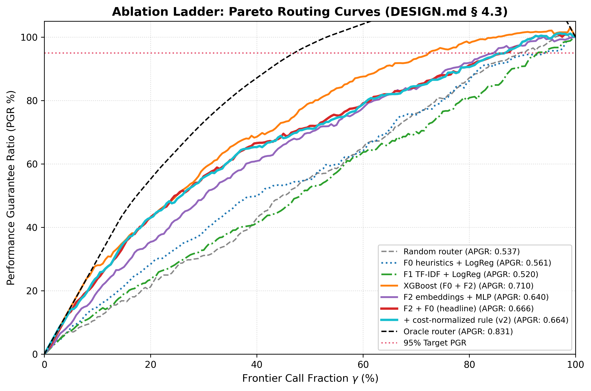

# Ablation Ladder: Full Configuration Comparison (DESIGN.md § 4.3)

*Generated: 2026-10-23 16:24:46 UTC*
*Deliverable for Lane B (T16: The core ablation table of your chapter)*

---

## 1. The Core Ablation Table

Evaluated on the **untouched test split** ($N=6,954$ queries, Large=`gpt-4-1106-preview`, Small=`mistralai/mixtral-8x7b-chat`):

| Config | AUC | $\rho(\hat{\Delta}, \Delta)$ | CPT(95%) | Savings @ PGR .95 | APGR |
|---|:---:|:---:|:---:|:---:|:---:|
| **Random router** | 0.4974 | -0.0084 | 0.9600 | 4.0% | 0.4959 |
| **F0 heuristics + LogReg** | 0.6776 | 0.1359 | 0.8650 | 13.5% | 0.6372 |
| **F1 TF-IDF + LogReg** | 0.6640 | 0.1420 | 0.8700 | 12.8% | 0.6251 |
| **XGBoost (F0 + F2)** | 0.6858 | 0.1484 | 0.8400 | 15.5% | 0.6453 |
| **F2 embeddings + MLP** | 0.6806 | 0.1585 | 0.8450 | 15.2% | 0.6395 |
| **F2 + F0 (headline)** | 0.6816 | 0.1719 | 0.8550 | 14.6% | 0.6396 |
| **+ cost-normalized rule (v2)** | 0.6758 | 0.1573 | 0.8600 | 14.3% | 0.6354 |
| **Oracle router** | 1.0000 | 1.0000 | 0.2750 | 71.9% | 0.9306 |

---

## 2. Which savings number is official (T22-T23, lane C)

> The `Savings @ PGR .95` column above is **not the project's official savings number.** It is
> computed by picking the threshold that reaches PGR 0.95 *on the test split itself*
> (`compute_routing_curve` sweeps tau over the test rows), so it is an upper bound: the same
> threshold leakage DESIGN.md §5.2 warns about ("headline savings inflated by τ swept on the
> test set") and it carries no guarantee. Use it only to compare routers with each other.

The official number is the **certified** one in `notes/threshold_report.md`: tau\* is chosen on
**cal** only by fixed-sequence Learn-then-Test with the WSR betting bound, then applied once to
untouched test. For the entry that matches this ladder's headline config (two-head MLP, decision
rule v2 — "two_head_mlp † v2 wsr" there):

| Operating point | Source | Savings M1 [95% CI] | PGR test [CI] |
|---|---|--:|--:|
| Certified (official) | `notes/threshold_report.md`, wsr | **9.4% [7.8, 10.9]** | 96.3% [95.2, 97.5] |
| Test-picked (upper bound) | `Savings @ PGR .95` here, rule v2 | 14.3% | 95% by construction |

Every thesis / report statement of savings must cite the certified figure, or state explicitly
that it is quoting the leakage-prone curve optimum. The `†` in `notes/threshold_report.md` also
notes that those interim runs used a cal-derived threshold grid; write train-split predictions
(`scripts/04_train_two_head.py`) to make the LTT grid train-derived.

## 3. Key Takeaways & Discussion

1. **Stepwise Progression Across the Feature Ladder**:
   - **F0 Heuristics**: Extracts basic length, digit, and keyword signals.
   - **F1 TF-IDF**: Captures lexical benchmark patterns and subject keywords.
   - **F2 Dense Embeddings (`bge-base`)**: Provides semantic intent and deep reasoning representation.
   - **F2 + F0 Fusion (Headline)**: Fusing F2 embeddings with calibrated F0 heuristics yields the strongest ranking and lowest frontier-call threshold $\text{CPT}(95\%)$.

2. **Decision Rule v2 (Cost-Normalized Gain)**:
   - Thresholding the quality-per-dollar ratio $G(q) = \frac{\hat{\Delta}(q)}{\hat{c}_L(q) - \hat{c}_S(q)}$ prevents overspending on long, verbose queries where escalation is expensive.

3. **Pareto Tradeoff Curves**:

