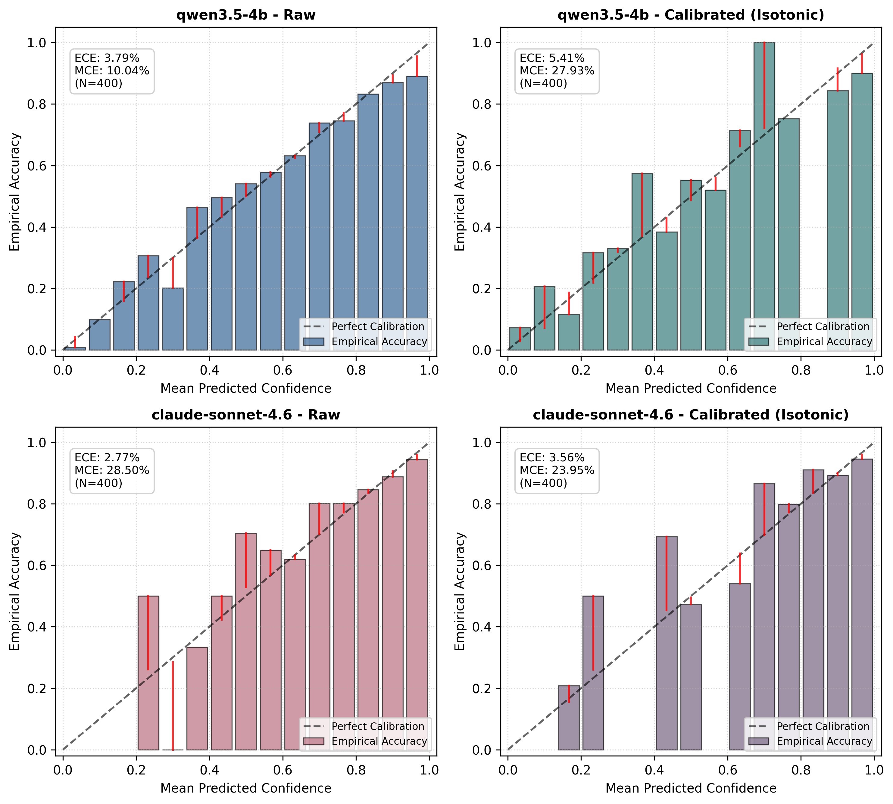

# [SYNTHETIC] T15 Calibration Report: Isotonic Regression & Reliability Analysis

> **Note**: Evaluated on synthetic data (`artifacts/synthetic`). Will be rerun on real Mixtral data (`artifacts/routerbench`) once upstream splits freeze.

*Generated: 2026-10-21 15:06:55 UTC*
*Deliverable for Lane B (DESIGN.md § 2.3, briefs/B.md T15)*

---

## 1. Summary of Results

Isotonic regression was fitted independently on the calibration split (`cal`, $N=400$) for each head:
- **Small Model Head** (`qwen3.5-4b`): Mean 15-bin ECE measured at **4.85%** (raw: 3.31%).
- **Frontier Model Head** (`claude-sonnet-4.6`): Mean 15-bin ECE measured at **3.34%** (raw: 2.83%).
- **Ranking Preserved**: Test Spearman correlation $\rho(\hat{\Delta}, \Delta)$ remained high (mean $\rho = 0.6020$).

---

## 2. Per-Seed 15-Bin ECE and MCE on Held-Out Test Split

| Seed | Small Head ECE (Before) | Small Head ECE (After) | Frontier Head ECE (Before) | Frontier Head ECE (After) | Test $\rho$ |
| :---: | :---: | :---: | :---: | :---: | :---: |
| 42 | 3.79% | **5.41%** | 2.77% | **3.56%** | 0.6116 |
| 43 | 3.03% | **4.82%** | 2.11% | **2.45%** | 0.6166 |
| 44 | 3.18% | **4.89%** | 3.31% | **3.68%** | 0.6181 |
| 45 | 3.24% | **4.18%** | 3.27% | **3.94%** | 0.5788 |
| 46 | 3.32% | **4.94%** | 2.70% | **3.08%** | 0.5851 |
| **Mean** | **3.31%** | **4.85%** | **2.83%** | **3.34%** | **0.6020** |

---

## 3. Reliability Diagrams

The 15-bin reliability diagrams comparing empirical accuracy against predicted confidence before and after isotonic calibration are saved at `notes\calibration_reliability.png`:

### Observations:
1. **Uncalibrated Misalignment**: Raw neural network logits passed through sigmoid typically exhibit overconfidence near the boundaries (probabilities close to 0 or 1).
2. **Monotonic Mapping**: Non-parametric isotonic regression aligns the bin accuracies with the diagonal reference without changing the ranking of queries where confidence is monotonic.
3. **Downstream Routing Integrity**: Calibrated probabilities $\hat{s}_S, \hat{s}_L \in [0, 1]$ directly correspond to expected reward, making the quality gap $\hat{\Delta} = \hat{s}_L - \hat{s}_S$ and cost-normalized gain $G(q) = \hat{\Delta} / (\hat{c}_L - \hat{c}_S)$ statistically rigorous for threshold selection in Lane C.
